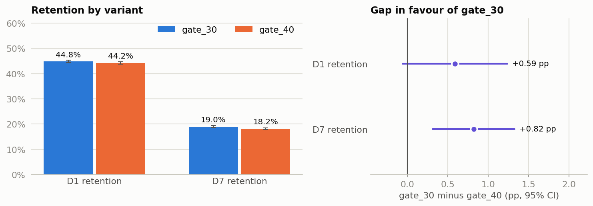

# Cookie Cats A/B test: should the first gate move from level 30 to 40?

A live-ops experiment readout on 90,189 players of a mobile match-3 game. **The recommendation is to keep the first gate at level 30.** Moving it to level 40 lowered D7 retention from 19.02% to 18.20%, a gap of 0.82 percentage points (95% CI 0.31 to 1.33, p = 0.0016) or 4.3% lower in relative terms. In resampling, gate_30 led in 99.9% of runs. D1 retention was not significantly different (44.82% vs 44.23%, p = 0.074), though the test was underpowered for a gap that small. One caveat is prominent in the readout: the 50/50 split failed its sample ratio check (p = 0.0086). The cause can't be diagnosed from this file, but it would overturn the D7 result only if at least 784 of the 789 surplus players weren't retained on day 7.



**Read next:** [decision memo](case_study.md) (one page, for a studio head) · [full notebook](cookie_cats_ab_test.ipynb)

The analysis is independent, uses a public dataset, and isn't affiliated with Tactile Entertainment. The data has no revenue column, so the monetisation side of the gate isn't measured.

## How to reproduce

```bash
python3 -m venv .venv && source .venv/bin/activate
```

```bash
pip install -r requirements.txt
```

```bash
curl -L -o data/cookie_cats.csv "https://raw.githubusercontent.com/yanny-alt/Cookie-Cats-A-B-Testing-Project/main/data/cookie_cats.csv"
```

```bash
python tools/build_notebook.py . narrative.json
```

```bash
python tools/test_sql.py .
```

The last command runs the BigQuery SQL in SQLite and should print `SQL vs Python: ALL MATCH`. The CSV isn't redistributed here; see [data/README.md](data/README.md).

## Repo structure

```text
.
├── case_study.md               one-page decision memo
├── cookie_cats_ab_test.ipynb   executed notebook
├── narrative.json              notebook prose
├── src/cookiecats.py           statistics as pure functions
├── sql/cookie_cats_bigquery.sql  the same analysis in BigQuery SQL
├── tools/
│   ├── build_notebook.py       runs the analysis, writes notebook and outputs
│   └── test_sql.py             checks the SQL against the Python
├── out/                        results.json, segment CSVs, charts
└── data/                       download instructions (CSV not committed)
```

## Skills

Experiment design · SRM · hypothesis testing · bootstrap · power analysis · BigQuery SQL · Python

## Contact

KinetiArc
