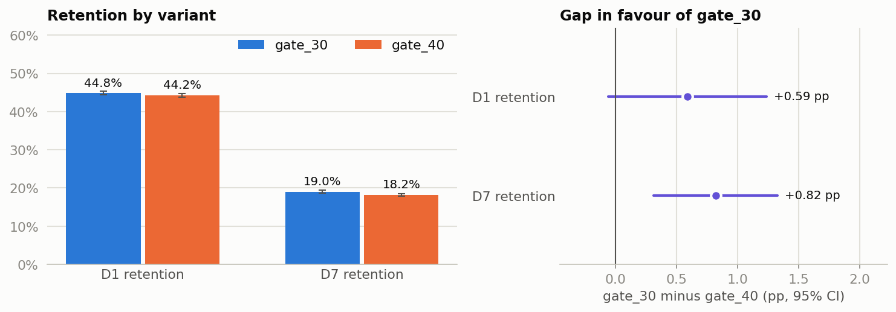
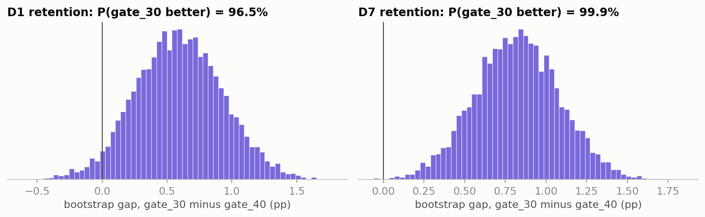

# Cookie Cats: should the first gate move to level 40?

*Rahul Jha, KinetiArc. Independent analysis of a public dataset; not affiliated with Tactile Entertainment.*

## 1. Decision

**Keep the first gate at level 30, because moving it to level 40 significantly lowered day-7 retention.** One warning: the player split was not the 50/50 we intended, and a split this uneven would arise by chance only 0.86% of the time (a sample ratio mismatch). That could mean an assignment bug, logging loss, or bot filtering applied unevenly. The extra players never reached a gate, so the true gap is probably smaller than the 0.82 points measured (section 4).

## 2. What we tested

90,189 new players were randomised at install: 44,700 with the first gate at level 30, and 45,489 at level 40.
The main measure was day-7 retention, with day-1 retention as a safety check.

## 3. What happened

| | Level 30 | Level 40 | Gap (percentage points) | 95% range of gap | Relative change, level 40 | Significant? |
|---|---|---|---|---|---|---|
| **Day 7** | 19.02% | 18.20% | 0.82 | 0.31 to 1.33 | 4.3% lower | Yes |
| **Day 1** | 44.82% | 44.23% | 0.59 | −0.06 to 1.24 | 1.3% lower | No |

When we resampled the results 10,000 times, level 30 came out ahead on day 7 in 99.9% of runs, and on day 1 in 96.5%.

**Drop-off:** gate_30 loses more players around 35–44 rounds, the one clear difference, but gate_40 shows no sign of a boredom cliff after 40 ([chart](out/05_dropoff_by_round.png)).

| Retention and gap | Resampled gap |
|---|---|
|  |  |

## 4. Can we trust it?

- **Player split:** level 40 has 789 more players, all among those with under 30 rounds (28,044 vs 28,876). At 30 rounds or more the groups are even (16,656 vs 16,613). Those extra players can't have met a gate, so the gate didn't cause this. Removing them at their group's retention rate cuts the day-7 gap to 0.57 points (range 0.06 to 1.08), still significant.
- **Players who could meet a gate:** their day-7 gap is 0.87 points, but not significant by itself (43.88% vs 43.00%).
- **Outlier:** one level 30 player logged 49,854 rounds in 14 days. Removing them leaves the day-7 gap at 0.82 points.
- **Test sensitivity:** the smallest gap this test could reliably catch is 0.72 points on day 7 and 0.93 on day 1. The day-1 gap is below that, so "not significant" doesn't mean "no effect".

## 5. What it means for the business

Per 100,000 installs, the measured day-7 gap is about 820 players lost by day 7 (range 312 to 1,328). With the extra players removed, it is about 568 (range 57 to 1,080). This is arithmetic on retention, not a revenue claim.

## 6. Next experiment

First find out why low-engagement players are over-represented at level 40. Each test below checks the split before anyone reads results, with day-1 retention and rounds played as guardrails, and logs revenue.

- **Level 25 vs level 30.** Hypothesis: an earlier gate raises day-7 retention. Metric: day-7 retention. Sample: 74,882 players per arm, to catch a 0.57-point gap.
- **Shorter wait at level 30 vs the current wait.** Hypothesis: a softer gate keeps more players to day 7, and logged revenue shows what that costs. Metric: day-7 retention. Sample: 96,714 players per arm, to catch a 0.5-point gap.

## 7. Limitations

- There is no revenue data, so a later gate's effect on monetisation is unmeasured.
- Only day-1 and day-7 retention exist, so nothing can be said about day 30.
- Rounds aren't levels: failed attempts count, so we can't see who reached a gate or measure true level-by-level drop-off.
- Rounds are measured after assignment, so any split above 30 rounds is descriptive, not causal.
- The cause of the uneven split is unknown, and the file has no dates, traffic source or device data to diagnose it.
